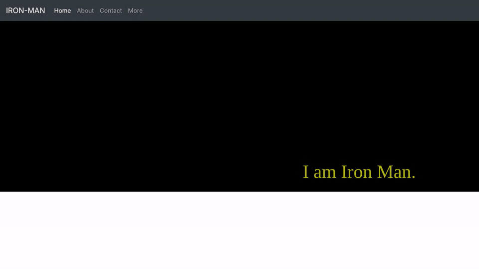

# Iron Man Homepage

A small four-page static website about Iron Man, built with HTML, Sass and Bootstrap 4. It was my Project 0 for Harvard's CS50 Web Programming with Python and JavaScript, where the goal was to practice HTML structure, CSS/Sass, Bootstrap's grid and media queries.



## Features

- **Four linked pages:** Home, About, Contact and More, joined by a shared Bootstrap navbar that collapses into a menu button on small screens.
- **Home page grid:** a Bootstrap row with two columns, an image on one side and the "I am Iron Man." text on the other.
- **Responsive styling:** a media query for screens up to 600px wide shrinks the font and the image.
- **Table:** the About page shows a profile table (name, age, height, weight).
- **Lists:** the Contact page uses an unordered list and an ordered list.
- **Sass:** the styles are written in `style.scss`, using nesting, a placeholder selector with `@extend` and a media query, then compiled to `style.css`.

## How it works

There is no build step or JavaScript of my own. Each page is plain HTML that loads Bootstrap 4.4.1 (CSS and JS, plus jQuery and Popper) from public CDNs, followed by the compiled `style.css`. Styling is written in `style.scss` and compiled with Sass, which also produces `style.css.map`.

## Project structure

```
index.html       Home page (image and text in a two-column grid)
about.html       Table
contact.html     Unordered and ordered lists
more.html        Text styled by id
style.scss       Sass source
style.css        Compiled CSS (with style.css.map)
docs/demo.gif    Demo recording
```

## Running it locally

Any static file server works. With Python 3:

```bash
git clone https://github.com/sangyetenphel/homepage.git
cd homepage
python3 -m http.server 8000
```

Then open http://127.0.0.1:8000. The pages need an internet connection to load Bootstrap from its CDN.

To change the styles, edit `style.scss` and recompile it with [Sass](https://sass-lang.com/):

```bash
sass style.scss style.css
```

## Built with

- HTML5
- CSS and [Sass](https://sass-lang.com/)
- [Bootstrap 4.4.1](https://getbootstrap.com/docs/4.4/)

## Course credit

Built for Project 0 of [CS50's Web Programming with Python and JavaScript](https://cs50.harvard.edu/web/) (Harvard University, 2020 edition). The original course submission video is on [YouTube](https://youtu.be/Kl_BnEh_-4o).

## Note on external resources

The home page image is loaded from an external image host rather than stored in this repository. It did not load when the demo above was recorded, so the left column of the home page appears empty.

Created by Sangye Tenphel, 2020.
